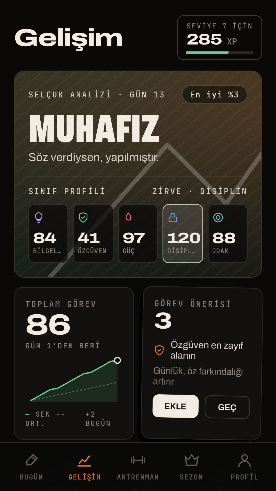
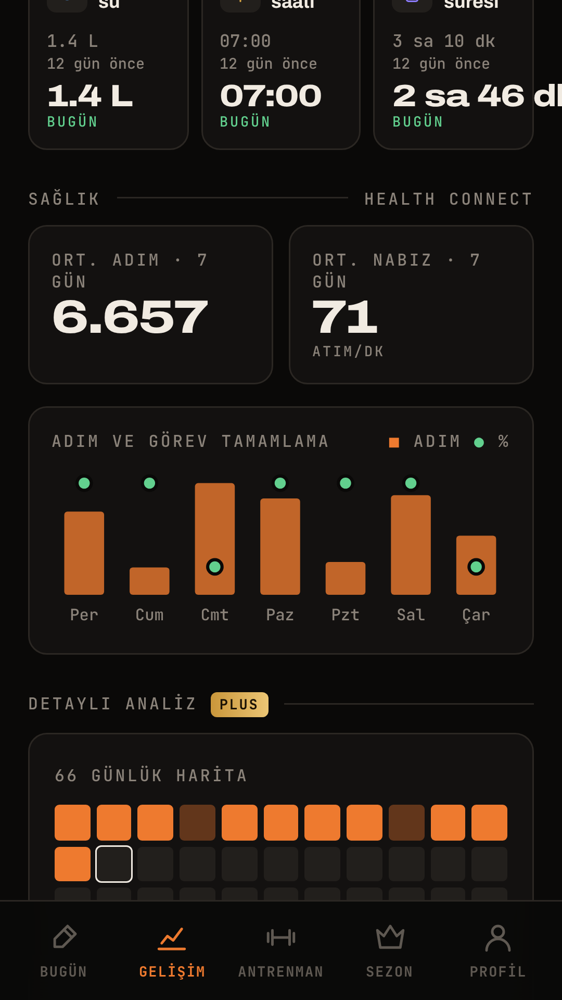
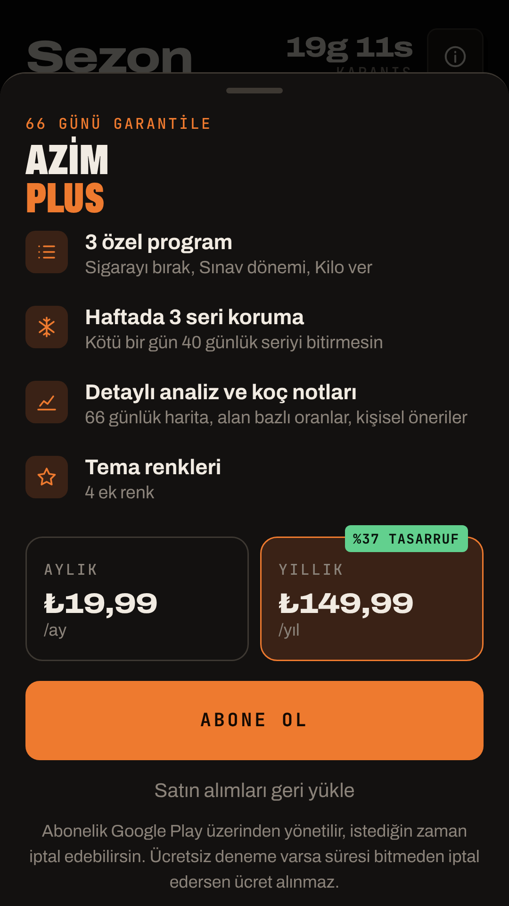

<h1 align="center">AZİM 3.1 · Sağlık ve Alışkanlık</h1>

   

Yapım: **selcukyus** · Paket: `com.selcuk.azim` · Sürüm 3.1.0 (versionCode 4) · TR/EN
Web sürümü: https://sinekvalesii.github.io/AzimApp/ · Gizlilik: https://sinekvalesii.github.io/AzimApp/privacy.html

## Android Studio'da açma
1. **File > Open** ile bu klasörü seç ve Gradle senkronizasyonunun bitmesini bekle.
2. ▶ **Run** düğmesine bas. Proje Firebase dosyası olmadan da derlenir; bu durumda hesaplar cihazda tutulur.

## Mimari
Native Kotlin kabuğu ve MVVM. Arayüz (`assets/www/index.html`) WebView içinde çalışır ve web sürümüyle aynıdır.

| Katman | Dosya |
|---|---|
| ViewModel | `MainViewModel.kt`: depolama, sağlık ve kimlik işlemleri; sonuçları arayüze akış olarak iletir |
| Veri (Room) | `data/Db.kt`: `kv` (uygulama durumu) ve `health` (günlük adım/nabız) tabloları. 2.x verisi otomatik taşınır. |
| Sağlık | `health/HealthRepo.kt`: Health Connect'ten adım ve nabız okur (salt okunur) |
| Kimlik | Firebase Authentication (e-posta/şifre, şifre sıfırlama, hesap silme) |
| Abonelik | `Billing.kt`: Google Play Billing 8 |
| Bildirim | `Reminders.kt`, `Messages.kt`: uyanış/uyku saatine göre günde 7 bildirim + görev saatleri |
| Widget | `AzimWidget.kt`: ana ekranda görev işaretleme |
| Köprü | `AzimBridge.kt`: `window.AzimNative` |

**Uyarlanabilir zorluk:** Her görevin son 7 kaydında tamamlama oranı %85 ve üzeriyse ve son 3 gün üst üste tamamlandıysa hedef ×1,10 olur. Oran %40 ve altındaysa ×0,85 olur. Değişiklikten sonra hedef en az 3 gün sabit kalır. Son günün ortalama nabzı önceki günlerin ortalamasından %8 yüksekse artış yapılmaz. Çarpan 0,5–2,5 arasında tutulur. Bunun yanında 66 günlük aşamalar (Temel, İnşa, Ustalık) hedefleri kademeli büyütür.

**Sağlık-başarı ilişkisi:** Adım sayısı medyanın üstünde olan günlerle altında olan günlerin görev tamamlama oranları karşılaştırılır (Plus'ta detaylı analiz).

## Firebase girişi (ücretsiz Spark planı)
1. https://console.firebase.google.com adresinde proje oluştur, Android uygulaması ekle ve paket adı olarak `com.selcuk.azim` gir.
2. İndirdiğin `google-services.json` dosyasını `app/` klasörüne koy. Bu dosya `.gitignore` içinde, repoya yüklenmez.
3. **Authentication > Sign-in method** bölümünde **E-posta/Şifre**'yi aç ve yeniden derle.

## Abonelik: AZİM Plus (düşük ücretli)
Ücretsiz: tüm görevler, uyarlanabilir zorluk, sağlık takibi, bildirimler, widget, antrenman, sezon.
Plus: 3 ek program, haftada 3 seri koruma, detaylı analiz ve sağlık-başarı ilişkisi, tema renkleri. Ödeme ekranı yalnızca 8. günde bir kez kendiliğinden açılır.

Play Console > Para kazanma > Abonelikler bölümünde iki ürün oluştur:
- `azim_plus_monthly` (öneri: ₺19,99/ay)
- `azim_plus_yearly` (öneri: ₺149,99/yıl)

Uygulama fiyatı Play'den okur; sunucu gerekmez. Lisans testi için kendi Gmail adresini ekle.

## Maliyet
Firebase Spark, Health Connect, GitHub Pages ve GitHub Actions ücretsiz. Tek ödeme Google Play geliştirici hesabı: 25 $, tek sefer.

## Yayın
- İmzalı AAB: **Build > Generate Signed App Bundle**. Alternatif olarak repo Secrets'a `KEYSTORE_BASE64`, `KEYSTORE_PASSWORD`, `KEY_ALIAS` ve `KEY_PASSWORD` ekle; CI imzalı AAB üretir (`git tag v3.1.0 && git push --tags`).
- Play Console formları:
  - **Health Connect izin beyanı:** READ_STEPS ve READ_HEART_RATE, amaç "fitness ve sağlıklı yaşam".
  - **Sağlık uygulamaları beyanı.**
  - **Veri güvenliği:** E-posta toplanıyor (hesap yönetimi, Firebase). Sağlık verisi cihazda işleniyor, paylaşılmıyor.
  - **Hesap silme adresi:** gizlilik sayfası.
- Kişisel geliştirici hesabında üretime çıkmadan önce kapalı test şartı var (12 test kullanıcısı, 14 gün). Güncel koşulu Play Console'dan kontrol et.
- Arayüzü değiştirince `docs/index.html` ve `app/src/main/assets/www/index.html` dosyaları aynı kalmalı; CI bunu kontrol eder.
