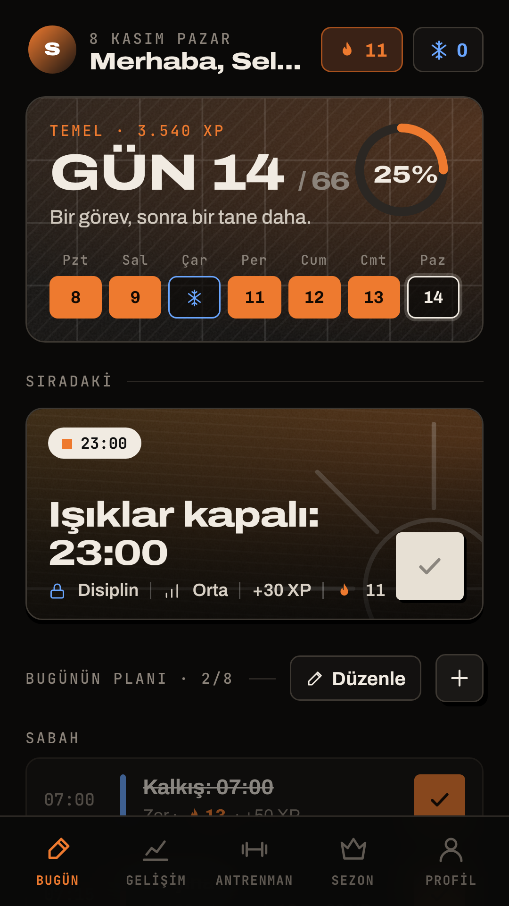
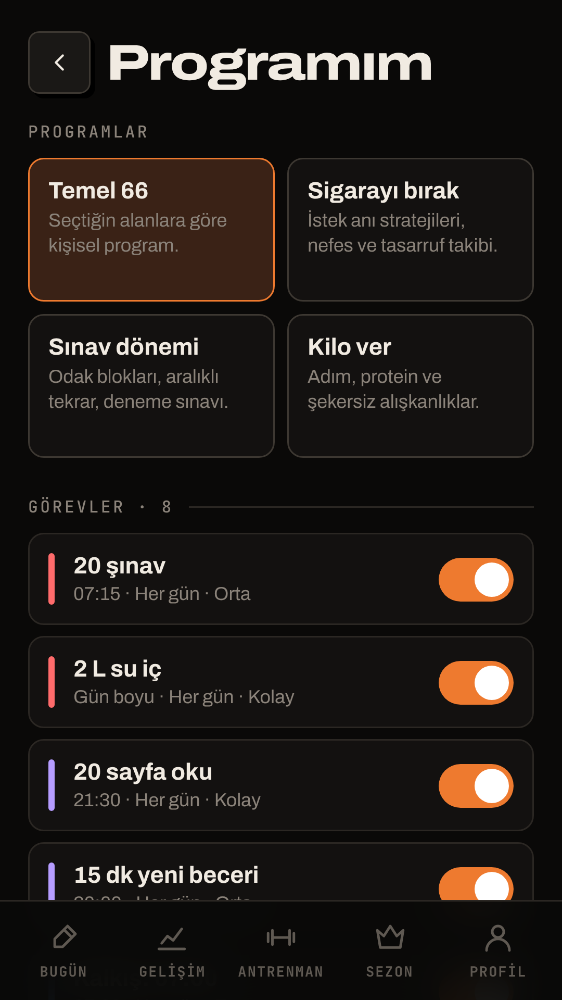
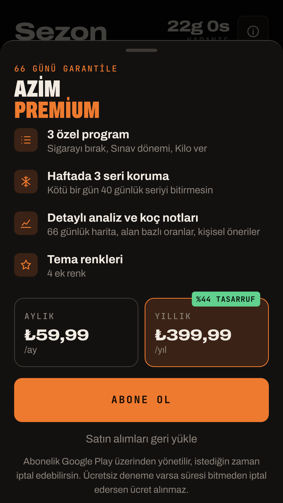

<h1 align="center">AZİM · 66 Günlük Alışkanlık</h1>

   

## Hızlı bağlantılar
- **Gizlilik politikası (Play Console'a girilecek adres):** https://sinekvalesii.github.io/AzimApp/privacy.html
- **Hazır APK / AAB:** [Actions](https://github.com/sinekvalesii/AzimApp/actions) sekmesi > son başarılı derleme > *Artifacts*. `v*` etiketiyle yayınlanan sürümler [Releases](https://github.com/sinekvalesii/AzimApp/releases) sayfasında.
- **Mağaza metinleri ve görseller:** [`play-store/`](play-store)

## Otomatik derleme (GitHub Actions)
Her push'ta `.github/workflows/android.yml` şunları üretir:
- debug APK (telefona doğrudan kurmak için)
- release AAB (Play Store'a yüklenecek dosya)
- release APK
- lint raporu

**İmzalı release için** reponun *Settings > Secrets and variables > Actions* bölümüne 4 secret ekle:

| Secret | Değer |
|---|---|
| `KEYSTORE_BASE64` | `base64 -w0 azim-upload.jks` çıktısı (Windows: `certutil -encode`) |
| `KEYSTORE_PASSWORD` | keystore şifresi |
| `KEY_ALIAS` | `upload` |
| `KEY_PASSWORD` | anahtar şifresi |

Secret yoksa release dosyaları imzasız üretilir. Bu durumda imzalamayı Android Studio'da yaparsın.

Yeni sürüm yayınlamak için: `app/build.gradle.kts` içindeki `versionCode` değerini artır, sonra `git tag v2.0.1 && git push --tags` çalıştır. İmzalı APK ve AAB Releases sayfasına otomatik eklenir.

> ⚠️ Repo herkese açık. `.jks` dosyasını ve `keystore.properties` dosyasını asla commit'leme; `.gitignore` bunları zaten dışarıda tutuyor.

Yapım: **selcukyus** · Paket adı: `com.selcuk.azim` · Sürüm 2.0.0 (versionCode 2) · Türkçe + İngilizce

## 2.0'da yenilikler
| Özellik | Açıklama |
|---|---|
| Yeni tasarım | "Bugün" ekranı: gün kartı, ilerleme halkası, haftalık şerit, "Sıradaki" görev, Sabah/Öğleden sonra/Akşam/Gün boyu zaman çizelgesi |
| Seri koruma + tek kaçırma hakkı | Standart mod: tek kaçırılan gün seriyi bozmaz, iki gün üst üste kaçırırsan sıfırlanır. Haftada 1 seri koruma hakkı (Premium'da 3). Sert Mod'da ikisi de yok. |
| Görev saatleri | Her görevin kendi saati var ve o saatte ayrıca bildirim gelir (uygulama niyeti) |
| Vardiya / günlük düzen | Gündüz, Erken kalkan ve Gece vardiyası hazır düzenleri ile özel uyanış/uyku/antrenman saatleri. 7 genel bildirim bu saatlere göre kayar. |
| Ana ekran widget'ı | Gün, seri, ilerleme ve sıradaki 3 görev. Görevler widget'tan işaretlenebilir. |
| Düzenlenebilir görevler | Ad, hedef, birim, adım, günler, saat, alan, zorluk, hatırlatıcı. Ayrıca kütüphane ve görev duraklatma. |
| Premium (Google Play Billing 8) | 3 program (Sigarayı bırak, Sınav dönemi, Kilo ver), haftada 3 seri koruma, detaylı analiz ve koç notu, 4 tema rengi. Ödeme ekranı 8. günde bir kez gösterilir. |
| Yedekleme | Profil > Veriler > dışa ve içe aktar (metin olarak) |
| İngilizce | Profil > Dil. Bildirimler de seçilen dile geçer. |

## 1. Android Studio'da açma
1. Zip'i çıkar. Android Studio > **Open** > `Azim` klasörünü seç.
2. Gradle senkronizasyonu gerekli parçaları indirir (AGP 8.11.1, Kotlin 2.2.0, SDK 36, Billing 8.0.0).
   - "SDK Platform 36 eksik" uyarısında **Install** bağlantısına tıkla. AGP yükseltme önerisi gelirse **Upgrade Assistant** ile yükseltebilirsin.
3. Telefonu bağla ya da bir emülatör seç ve ▶ **Run** düğmesine bas. Debug sürüm `com.selcuk.azim.debug` adıyla kurulur.
4. Widget'ı denemek için ana ekrana uzun bas > Widget'lar > AZİM.

## 2. Dosyalar
| Dosya | Görevi |
|---|---|
| `assets/www/index.html` | Arayüzün tamamı (TR/EN). Tarayıcıda da açılır; orada "önizleme" moduyla çalışır. |
| `MainActivity.kt` | Tam ekran WebView, sistem çubukları, klavye, geri tuşu, bildirim izni |
| `AzimBridge.kt` | Arayüz ile Android arasındaki köprü: veri, bildirim planı, widget, satın alma, paylaşım |
| `Reminders.kt` | Bildirim planını kurar; görev bittiyse o görevin bildirimini atlar; yeniden başlatmada hepsini tekrar kurar |
| `Messages.kt` | TR/EN bildirim metinleri: motivasyon, su ve antrenman kuralları |
| `AzimWidget.kt` + `res/layout/widget_azim.xml` | Ana ekran widget'ı |
| `Billing.kt` | Google Play abonelikleri |

## 3. Premium kurulumu (Play Console)
1. Uygulamayı en az bir test kanalına yükle. Ürünler, uygulama Play'e yüklenmeden oluşturulamaz.
2. **Para kazanma > Abonelikler** bölümünde iki abonelik oluştur. ID'ler birebir aynı olmalı:
   - `azim_premium_monthly`: aylık temel plan (öneri: ₺59,99)
   - `azim_premium_yearly`: yıllık temel plan (öneri: ₺399,99). İstersen 7 günlük ücretsiz deneme teklifi ekle.
3. **Ayarlar > Lisans testi** bölümüne kendi Gmail adresini ekle. Böylece gerçek ödeme yapmadan test satın alması yapabilirsin.
4. Fiyatı değiştirirsen uygulamadaki fiyat otomatik güncellenir; fiyat Play'den okunur.

> Satın alma doğrulaması cihazda yapılıyor. Ölçek büyüdüğünde sahteciliğe karşı sunucu tarafı doğrulama (Google Play Developer API) eklenmeli.

## 4. Yayın paketi (AAB)
1. **Build > Generate Signed App Bundle / APK > Android App Bundle** ile yükleme anahtarı oluştur. `.jks` dosyasını ve şifresini güvenli yere yedekle.
2. **release** seç. Çıktı: `app/release/app-release.aab`.
3. Her güncellemede `versionCode` değerini 1 artır.

## 5. Play Console formları
- **Veri güvenliği:** Uygulama veri toplamıyor ve paylaşmıyor (internet izni yok; veriler cihazda). Satın alma işlemini Google Play yürütür. Formu doldururken Google'ın güncel rehberine bak.
- **Sağlık uygulamaları beyanı:** Fitness ve sağlıklı yaşam.
- **Hedef kitle:** 18+ (ya da 13+). Çocuklara yönelik değil.
- **Reklam:** Yok.
- **Uygulama erişimi:** Özel giriş bilgisi gerekmiyor; hesap cihazda oluşturuluyor.
- **Mağaza girişi:** `play-store/magaza-metinleri.md` dosyasında TR ve EN metinler, `screenshots/tr` ve `screenshots/en` klasörlerinde görseller var. EN için Play Console'da "Çeviri ekle > İngilizce" ile ayrı mağaza girişi oluştur.
- **Gizlilik politikası:** https://sinekvalesii.github.io/AzimApp/privacy.html (TR + EN, `docs/` klasöründen GitHub Pages ile yayınlanıyor)
- **Kapalı test:** Kişisel geliştirici hesaplarında üretime çıkmadan önce 12 test kullanıcısıyla 14 gün kapalı test şartı var. Güncel koşulu Play Console panosundan kontrol et.

## 6. Bilinen sınırlar / sonraki adımlar
- **Bulut hesabı, gerçek lig, arkadaş serisi ve çökme raporlama (Crashlytics)** senin Firebase projeni gerektiriyor. Firebase Console'da proje oluşturup `google-services.json` dosyasını gönderdiğinde eklenebilir. O zamana kadar Sezon ekranındaki sıralama "örnek lig" olarak etiketli.
- Bildirimler birkaç dakika sapabilir; Play, tam zamanlı alarm iznini yalnızca alarm uygulamalarına veriyor.
- Pil tasarrufu agresif olan telefonlarda (Xiaomi, Huawei, Oppo): Ayarlar > Pil > AZİM > **Kısıtlama yok**.
- Widget'tan işaretlenen görevin XP'si, uygulama bir sonraki açılışta işlenir.
